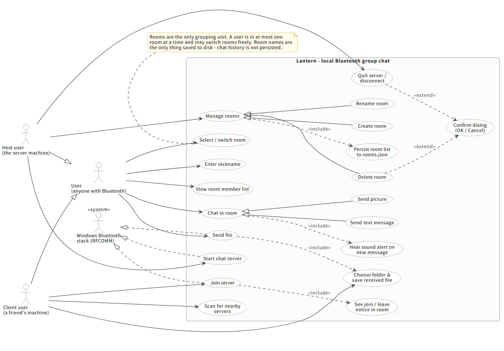
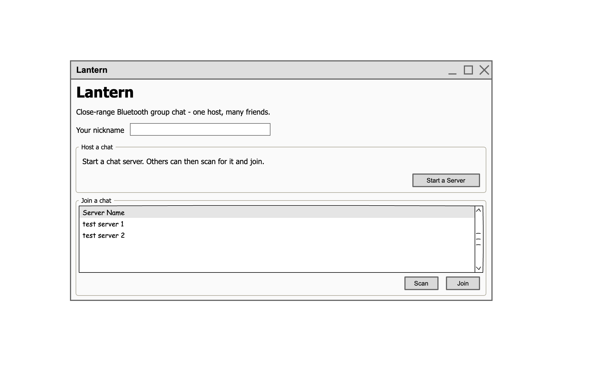
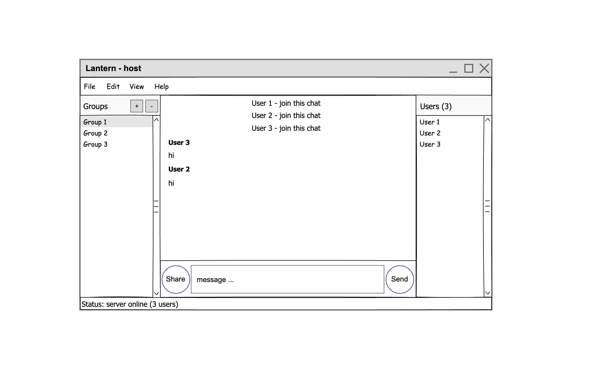
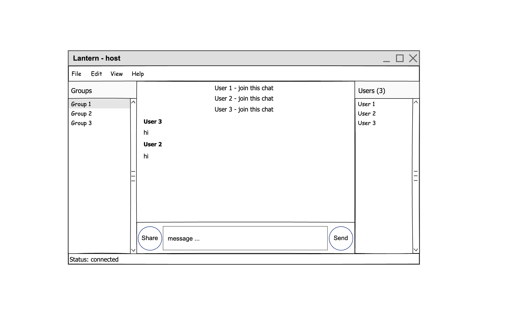
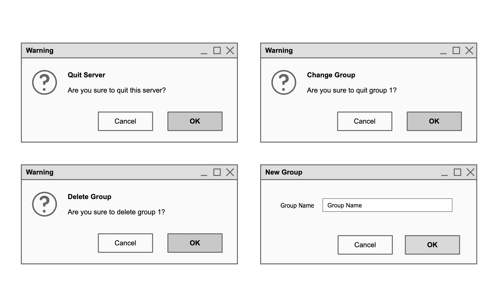
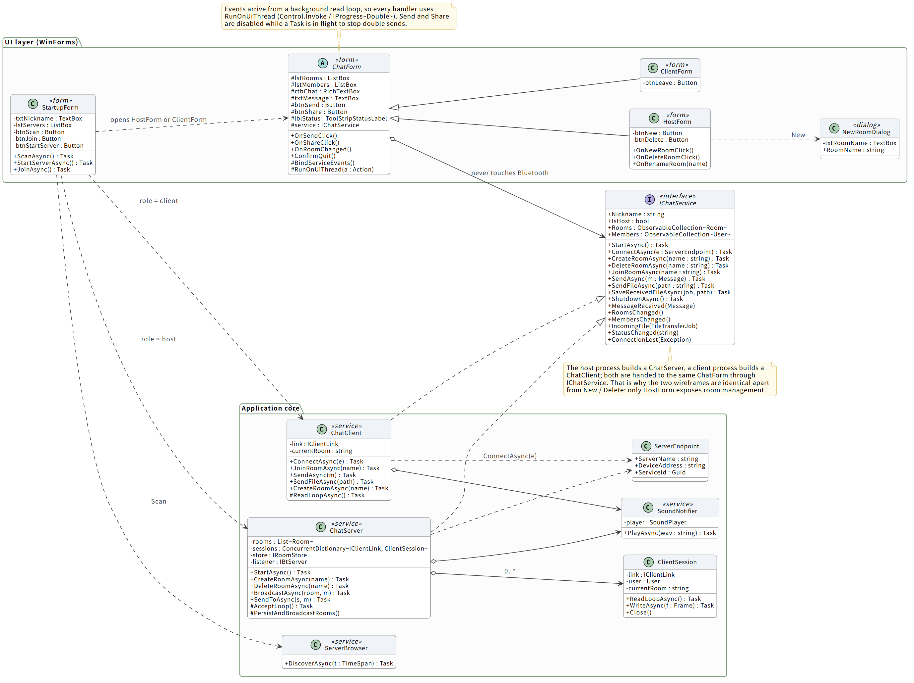
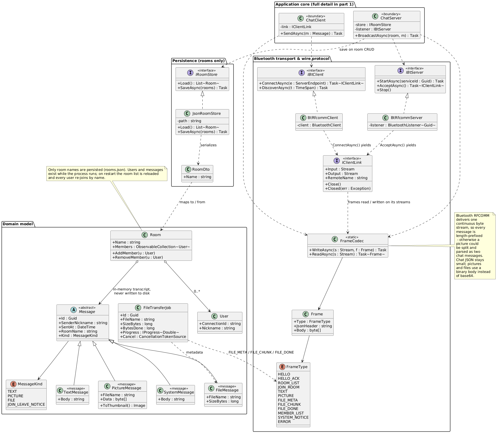

::: {custom-style="APACenter"}
:::

::: {custom-style="APACenter"}
**Lantern: A Local Bluetooth Group Chat for Windows**
:::

::: {custom-style="APACenter"}
Haitao Yang
:::

::: {custom-style="APACenter"}
Julia Ferreira Moraes Welerson
:::

::: {custom-style="APACenter"}
Okechukwu Ebogu
:::

::: {custom-style="APACenter"}
Victory Oleru
:::

::: {custom-style="APACenter"}
\[Department\], \[Institution\]
:::

::: {custom-style="APACenter"}
SODV 2101, Rapid Application Development
:::

::: {custom-style="APACenter"}
\[Instructor name\]
:::

::: {custom-style="APACenter"}
\[Institution\]
:::

::: {custom-style="APACenter"}
September 29, 2026
:::

```{=openxml}
<w:p xmlns:w="http://schemas.openxmlformats.org/wordprocessingml/2006/main"><w:r><w:br w:type="page"/></w:r></w:p>
```

# Introduction

Lantern is a Windows chatting application written in C# with Windows Forms. It lets a small group of people chat over a Bluetooth connection, without Wi‑Fi or an internet connection. One machine works as the host (server) and the other machines connect to it as clients. The host organizes the chat into named rooms, and each client picks one of those rooms to chat with everyone in it.

Lantern is useful whenever a few people nearby need to communicate without the internet: a study group whose Wi‑Fi went down, a classroom exercise, a lab, or an outdoor activity. Messages support text and pictures, and users can also send and receive files.

The project deliberately covers the main topics of this course:

- **User interfaces.** WinForms windows, dialogs, menus, list boxes, and a status bar.
- **Event-driven programming.** Button clicks, selection changes, and events raised by the chat services.
- **Asynchronous and concurrent programming.** async/await, background read loops, and progress reporting so the interface stays responsive.
- **Networking.** Bluetooth RFCOMM sockets and a small custom message protocol.
- **Data connections.** The room list is persisted as JSON (*rooms.json*) on the host machine.

Lantern needs no accounts, no internet, and no third-party data. All communication happens between the machines over Bluetooth.

# Use Cases

Figure 1 shows the use case diagram for Lantern. The two main actors are the host user (the machine that runs the server) and the client user (everyone else). Both can enter a nickname, chat in a room, view the room's member list, and send files. Only the host user manages rooms; only the client user scans for servers, joins one, and saves received files.

::: {custom-style="APAFig"}
**Figure 1.** Use case diagram for Lantern
:::

{width="8in"}

A few concrete scenarios:

1. **Host a chat.** Alice opens Lantern, types her nickname, and clicks **Start a Server**. Her machine becomes the host. Room names saved from earlier sessions (*rooms.json*) are loaded, and the status bar shows “server online”.
2. **Join a chat.** Bob opens Lantern, types his nickname, and clicks **Scan**. Alice's server appears in the list. He selects it and clicks **Join**. Alice's room list appears in his window.
3. **Manage rooms.** Alice creates a new room, renames a room, or deletes a room. Only the host can do this. Every change is saved to *rooms.json* right away and broadcast to all connected clients.
4. **Chat.** Alice and Bob open the same room and exchange text messages and pictures. A short sound plays for every new message. When someone enters or leaves a room, a system line such as “Cara - join this chat” appears in that room.
5. **Share a file.** Bob picks a file to send. Its name, size, and content are delivered to the other members of the room. Each receiver chooses a folder, and the file is saved there with a progress indicator.
6. **Leave.** Alice confirms that she wants to quit the server, and the server shuts down. Bob's window reports that the connection was lost.

# Key Features

Table 1 lists the features we plan to implement.

::: {custom-style="APAFig"}
**Table 1.** Planned features of Lantern
:::

| #  | Feature                 | Description                                                                                          |
|:---|:------------------------|:----------------------------------------------------------------------------------------------------- |
| F1 | Windows Forms app       | C# .NET 10 desktop application built with WinForms for Windows 10/11.                                 |
| F2 | Bluetooth networking    | Close-range chat over Bluetooth RFCOMM; one machine hosts and the others connect as clients.          |
| F3 | Server discovery        | A client scans for nearby host servers and lists them by name.                                        |
| F4 | Nickname                | Every user enters a nickname when the app starts.                                                     |
| F5 | Room management (host)  | The host creates, renames, and deletes rooms; every room has a name.                                  |
| F6 | Room list and switching | Clients see the host's room list, pick a room, and can switch rooms; a user is in one room at a time. |
| F7 | Text and picture chat   | Messages support plain text and pictures, shown as inline thumbnails.                                 |
| F8 | File transfer           | Send a file to the room; the receiver picks a folder to save it in, with a progress indicator. Large files are sent in chunks. |
| F9 | Room persistence        | Room names persist in *rooms.json* on the host machine; chat history is not saved.                    |
| F10| Sound notification      | A sound plays whenever a new message is received.                                                     |
| F11| Join/leave notices      | A system message is posted in a room when a user joins or leaves it.                                  |
| F12| Room member list        | Each room shows a list of all users currently in it.                                                  |

# Supporting Materials

- **Hardware.** At least two laptops with Windows 10/11 and working Bluetooth radios — one as host, one as client. A third machine is helpful for testing several clients at once.
- **Software.** Visual Studio 2022 with the .NET 10 desktop workload. No paid tools are required.
- **Libraries.** Windows Forms and System.Text.Json are part of the .NET runtime, so nothing extra has to be installed. For Bluetooth sockets we plan to use the built-in System.IO.Ports classes (*BluetoothListener* and *BluetoothClient*); if those turn out to be insufficient we will fall back to the open-source 32feet.NET package.
- **Test data.** A few sample pictures and files of different sizes, to test messages and file transfer.

No internet access or third-party data service is needed at any point.

# User Interface Design

The application has one startup window and one main chat window. The main chat window looks almost the same for host and client; the only difference is that the host gets room-management buttons (see the class diagram, Figure 6). Note that the wireframes below label the room list as “Groups” for simplicity; the final application will use the word “Room”.

::: {custom-style="APAFig"}
**Figure 2.** Initial (startup) window
:::

{width="8in"}

When the app starts, the user types a nickname and chooses one of two actions. **Host a chat** starts a Bluetooth server on this machine. **Join a chat** scans for nearby servers, lists them, and lets the user join one. The status bar at the bottom reports the connection state.

::: {custom-style="APAFig"}
**Figure 3.** Host window
:::

{width="8in"}

This is the main window of the host. The left panel lists the rooms and has **New** and **Delete** buttons for room management. The center panel shows the messages of the selected room, including join/leave notices. The right panel lists the members of the current room. At the bottom, the user types a message and clicks **Send**, or clicks **Share** to attach a picture or a file.

::: {custom-style="APAFig"}
**Figure 4.** Client window
:::

{width="8in"}

This is the main window of a client. The layout is the same as the host's window, but the room list is read-only (no **New** or **Delete** buttons) and a **Leave** button is added. The client picks a room from the host's list, chats, shares files and pictures, and saves received files to a folder of its choice.

::: {custom-style="APAFig"}
**Figure 5.** Confirmation and input dialogs
:::

{width="8in"}

Lantern uses small dialogs for anything destructive or that needs input. The host confirms before **Quit Server** and before **Delete Room**; a user confirms before leaving a room (“Change Group” in the wireframe). **New Room** asks for the room name. All dialogs use the simple OK/Cancel pattern.

# Initial Design

The design has five parts: the WinForms UI layer, an application core (*ChatServer*/*ChatClient*), the domain model (*Message*, *Room*, *User*), persistence (*rooms.json*), and the Bluetooth transport. Figures 6 and 7 show two class diagrams. Strict UML correctness is not the goal; the diagrams capture the decisions that will shape the code.

**One chat form for both roles.** The UI never talks to Bluetooth directly. It talks to an *IChatService* interface. The host process builds a *ChatServer* object and the client process builds a *ChatClient* object, and both are handed to the same chat form. That is why the host and client windows in Figure 3 and Figure 4 are identical apart from the room-management buttons.

**A binary, length-prefixed wire protocol.** Bluetooth RFCOMM delivers one continuous byte stream. If we sent raw text, a picture could arrive split across two “messages” and be misparsed. So every message is a frame: a 4-byte length prefix, a small JSON header, and an optional binary body. Chat text stays small JSON; pictures and files use a binary body instead of base64 to avoid overhead.

**Asynchronous everywhere.** Network input and output run in background tasks, and incoming events are marshaled to the UI thread (*Control.Invoke*), so the forms stay responsive. The **Send** and **Share** buttons are disabled while a send is in flight, to prevent double sends.

**Only room names are persisted.** A small *IRoomStore*/*JsonRoomStore* pair saves room names to *rooms.json* on the host and tolerates a missing or corrupt file. Chat history exists only in memory. When the host restarts, the room list is reloaded and users rejoin by name.

**The transport sits behind an interface.** *IBtServer*/*IBtClient*/*IClientLink* hide the Bluetooth details, so we can swap in a fake transport and test the chat logic without physical Bluetooth hardware.

::: {custom-style="APAFig"}
**Figure 6.** Class diagram: UI and service layer
:::

{width="8in"}

Figure 6 shows the UI and service layer: the forms, the *IChatService* interface, and the *ChatServer*/*ChatClient* core, including the room-management buttons that only the host exposes.

::: {custom-style="APAFig"}
**Figure 7.** Class diagram: domain model, persistence, and Bluetooth transport
:::

{width="8in"}

Figure 7 shows the domain model (message types, rooms, users, file transfer jobs), the JSON persistence, and the Bluetooth transport with the frame protocol.

This is an initial design; we expect it to change as we implement the project.

# Division of Work

Table 2 shows how we plan to divide the work, matching the roles in our group project contract.

::: {custom-style="APAFig"}
**Table 2.** Division of work
:::

| Member                          | Role                     | Responsibilities in Lantern                                                                                                                                        |
|:------------------------------|:----------------------------------|:----------------------------------------------------------------------------------------------------|
| Haitao Yang                       | Team lead                   | Startup form and the main application shell: menus, dialogs, navigation, and layout. Owns the Git repository, branch rules, and the milestone schedule.              |
| Julia Ferreira Moraes Welerson    | Developer, persistence/data | *rooms.json* format, *JsonRoomStore* load/save, the room CRUD data path, and asynchronous saving so the UI stays responsive.                                      |
| Okechukwu Ebogu                   | Developer, domain/core logic| The *Message* class hierarchy, *Room* and *User* classes, validation rules, and the event handling that connects the forms to the chat service.                    |
| Victory Oleru                     | Developer, networking       | The Bluetooth transport (RFCOMM sockets and the frame protocol), file transfer jobs, sound notifications, and the member list and status updates.                  |

We meet every Monday at 2:00 PM on MS Teams. Every module has one named owner and one backup. As in our contract, a feature counts as done only when it compiles without warnings, runs from the current main branch, is tested by someone who did not write it, and has a short note explaining how to use it.

# References

::: {custom-style="APARef"}
32feet. (n.d.). *32feet.NET: Bluetooth sockets for .NET on Windows* \[Computer software\]. GitHub. https://github.com/inthehand/32feet
:::

::: {custom-style="APARef"}
Microsoft. (n.d.). *System.IO.Ports namespace* \[.NET documentation\]. Microsoft Learn. https://learn.microsoft.com/en-us/dotnet/api/system.io.ports
:::

::: {custom-style="APARef"}
Microsoft. (n.d.). *Windows Forms overview* \[.NET documentation\]. Microsoft Learn. https://learn.microsoft.com/en-us/dotnet/desktop/winforms/
:::
